  

---

## 🌱 Sobre mí

- 🔭 Estoy desarrollando el panel web de un **sistema de riego con ESP32**
- 📚 Estoy aprendiendo **HTML, CSS y JavaScript**, y también **Git y GitHub**
- 🔌 Me interesa el **IoT** y la electrónica con Arduino
- 💬 Pregúntame lo que quieras sobre mis proyectos
- 🌿 Dato curioso: mi proyecto usa plantas como Monstera, Albahaca y Helecho

 

---

## 🛠️ Tecnologías

  

---

## 📊 Mis estadísticas

  
  

  

  

---

## 🦖 ¿Se cayó el internet?

  

El dinosaurio nació en una pantalla LCD de Arduino 🤖 y ahora vive aquí.
